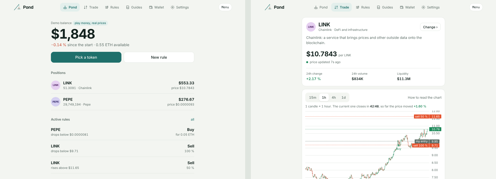
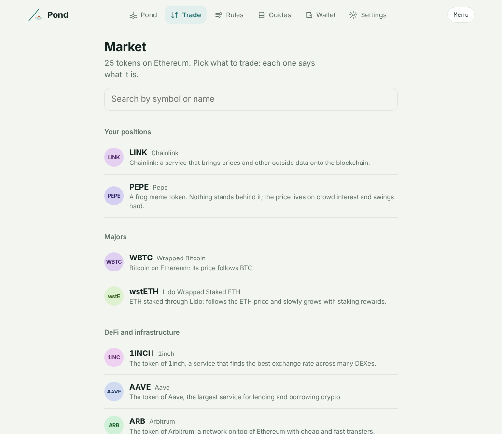
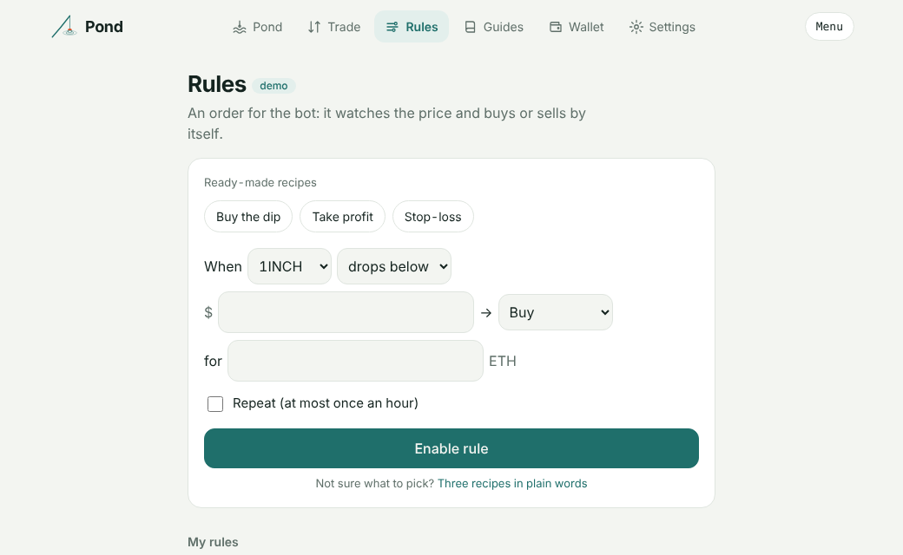
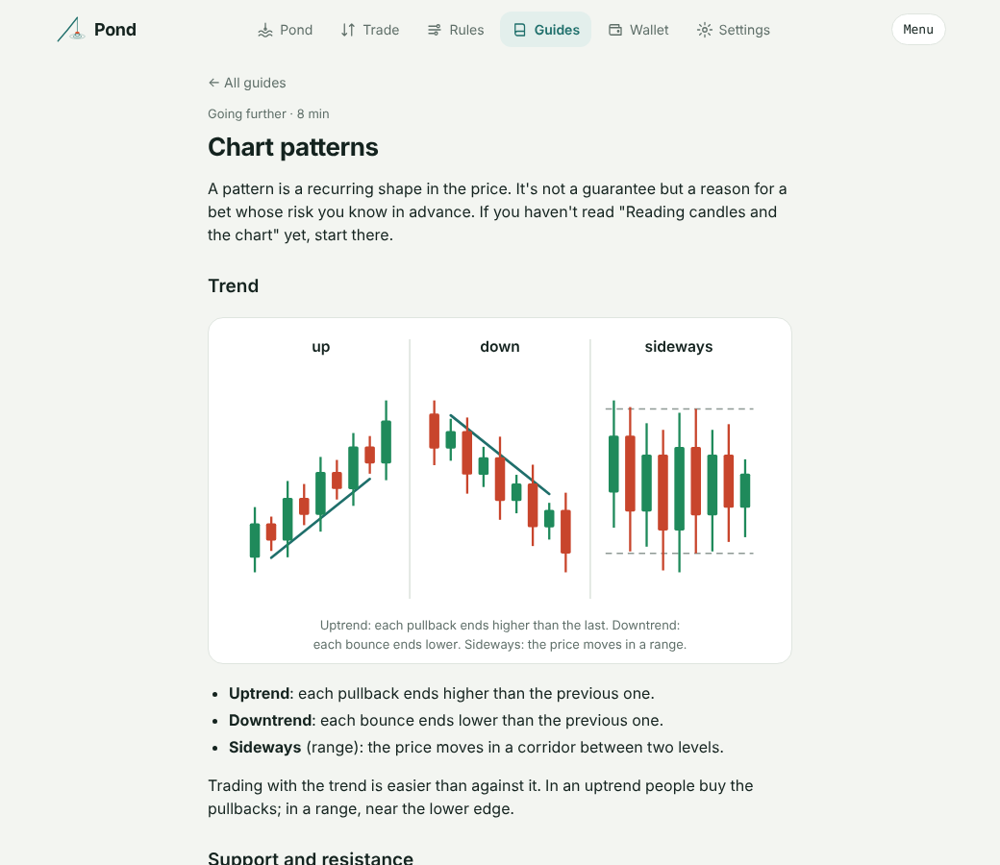
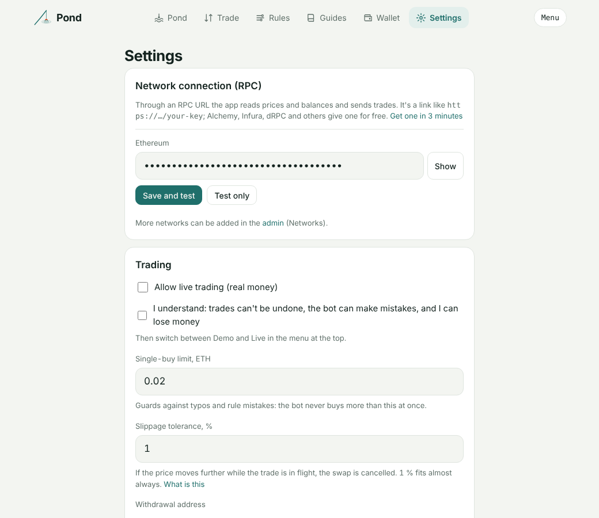
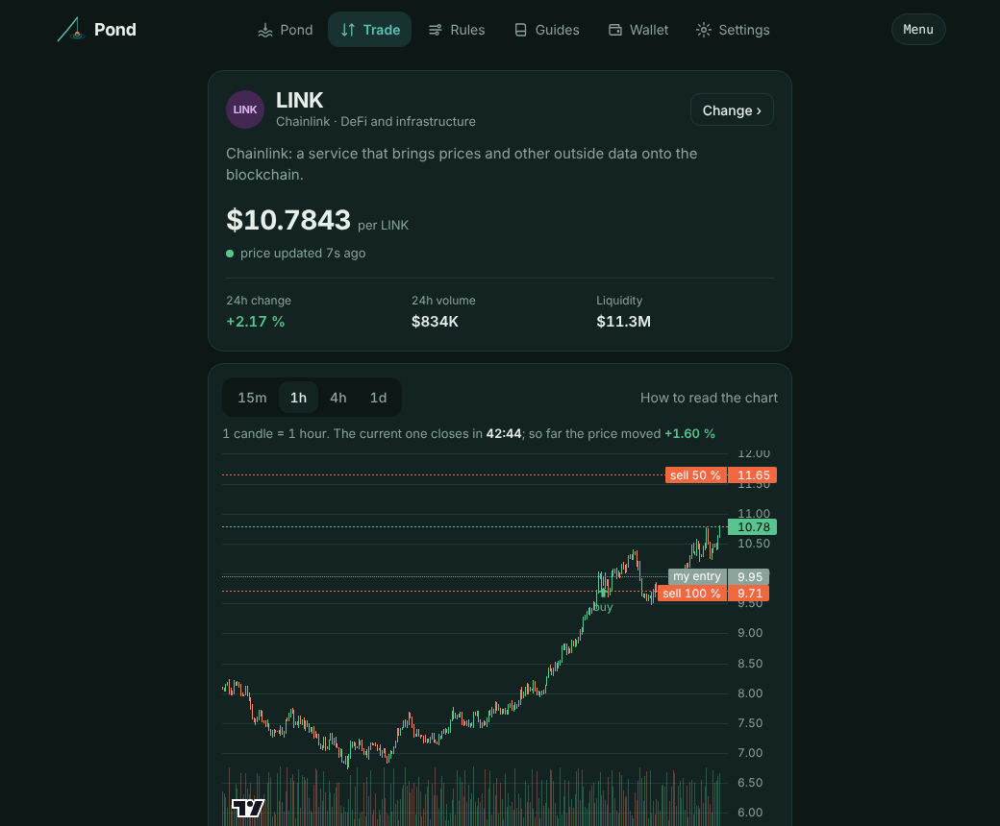
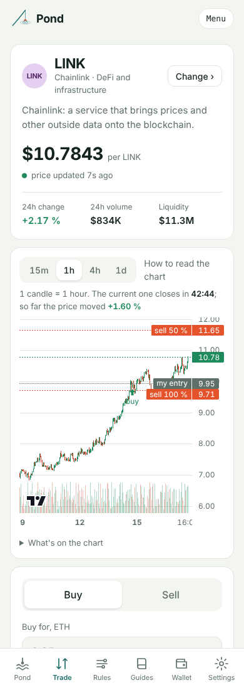

# Pond

**A calm, minimal crypto trading app that runs on your own computer.**

Trade tokens by hand, leave orders for a bot, and learn as you go: every token says what it is, and the built-in guides explain candles, patterns and risk in plain words. Start with play money and real prices; switch to real money only when you're ready.



> ⚠️ **Experimental software. Not financial advice.** Trading crypto can lose you money, and bots make mistakes. Live mode is new and has only been tested against a simulated chain. Use a separate wallet with an amount you can afford to lose.

## What you can do

- **Practice with play money.** You start with 1 demo ETH. Prices are real, straight from Uniswap. Start over any time.
- **Know what you're buying.** 25 well-known Ethereum tokens, grouped into majors, DeFi, memes and stablecoins, each with a one-line description. There's also a "Trending now" list, and you can add any token by its address.
- **Read the chart.** Candles and volume from 15 minutes to 1 day, a countdown to the next candle, and your own rules and average entry price drawn on top.
- **Let the bot trade.** Write a rule like "when LINK drops below $9, buy for 0.05 ETH" and the bot carries it out. One-click recipes: buy the dip, take profit, stop-loss.
- **Learn.** Illustrated guides: getting an RPC key, swaps and DEXes, gas and slippage, reading candles, candlestick patterns, chart patterns, scam tokens, risk management.
- **Trade for real, when you choose to.** Live mode swaps through Uniswap with a per-buy limit, a slippage limit and a second click to confirm.
- **Keep your keys.** Everything runs on your computer. The trading wallet's key is encrypted with your password and never leaves it.

| Market | Rules | Guides |
|---|---|---|
|  |  |  |
| **Settings** | **Dark theme** | **Narrow window** |
|  |  |  |

## Install

**Windows:** download `Pond-windows.zip` from [Releases](../../releases), unzip it anywhere and run `Pond.exe`.

The app isn't code-signed, so Windows SmartScreen may warn you the first time: click **More info → Run anyway**. If the window doesn't open and you see `Failed to resolve Python.Runtime.Loader.Initialize`, right-click the downloaded zip → **Properties** → tick **Unblock**, then unzip it again. If you'd rather not run a downloaded program, run Pond from source instead: it's the same code.

**From source (Windows, macOS, Linux):** you need Python 3.11 or newer.

```bash
git clone https://github.com/lumecather/pond.git
cd pond
python -m venv .venv
.venv\Scripts\activate          # macOS/Linux: source .venv/bin/activate
pip install -r requirements.txt
python desktop.py
```

If the window doesn't open, `python desktop.py --browser` runs the same app in your regular browser.

## Getting started

1. **Choose a password.** It protects the trading wallet's key. It can't be recovered, so write it down, just like with Rabby or MetaMask.
2. **Paste an RPC URL** in Settings. It's a free link that lets the app read the blockchain; Alchemy, Infura and dRPC give one in a couple of minutes. The in-app guide "Getting an RPC key" shows exactly where to click.
3. **Trade in demo.** Pick a token on the Market tab, buy a little, then set a rule on the Rules tab. Read "First steps" in Guides.
4. **Going live (optional):**
   - On the Wallet tab, create a trading wallet (or import one you made just for the bot).
   - In Settings, add your main wallet as the withdrawal address and allow live trading.
   - Send a small amount of ETH to the trading wallet.
   - Switch to **Live** in the menu at the top. Trades now use real money.

The bot only works while Pond is open.

## FAQ

**Is my money safe?**
Pond never sees the key of your main wallet. The bot uses a separate trading wallet whose key is stored on your computer, encrypted with your password. Keep only what you're ready to risk in it. See [SECURITY.md](SECURITY.md) for details.

**Does Pond cost anything?**
No. The RPC providers' free plans are enough for one person. On-chain trades cost network gas, as anywhere.

**Where do the tokens come from?**
The main list is a hand-picked set of well-known tokens that ships with the app. "Trending now" is fetched automatically from GeckoTerminal every few minutes, so tokens appear there and drop off by themselves; they are not checked for scams. A token you open from that list or add by address stays under "Added by you" until you remove it (on its Trade page).

**Where is my data?**
In `%APPDATA%\Pond` (Windows), `~/Library/Application Support/Pond` (macOS) or `~/.local/share/pond` (Linux). Copy that folder to move Pond to another computer.

**I forgot my password.**
It can't be recovered. Delete the data folder to start over. If the trading wallet still holds money, you'll need its private key (Wallet → Show key) to get it back, so save the key somewhere safe while you still can.

**Which networks?**
Ethereum for now. More are on the roadmap.

## Roadmap

- Linked rules: take profit and stop-loss on one position, where one cancels the other
- Trailing stop and percentage-based rules
- Telegram notifications when a rule fires
- More networks: Base, Arbitrum, Robinhood Chain

Ideas and pull requests are welcome: see [CONTRIBUTING.md](CONTRIBUTING.md).

## License

Copyright (C) 2026 lumecather

Pond is licensed under the GNU General Public License v3.0 or later. See LICENSE.

---

Made by [lumecather](https://github.com/lumecather). Also check out **[QuackTool](https://quacktool.com)**, an NFT sniper that catches reveals, ranks rarity and buys rare tokens cheap by your rules.
